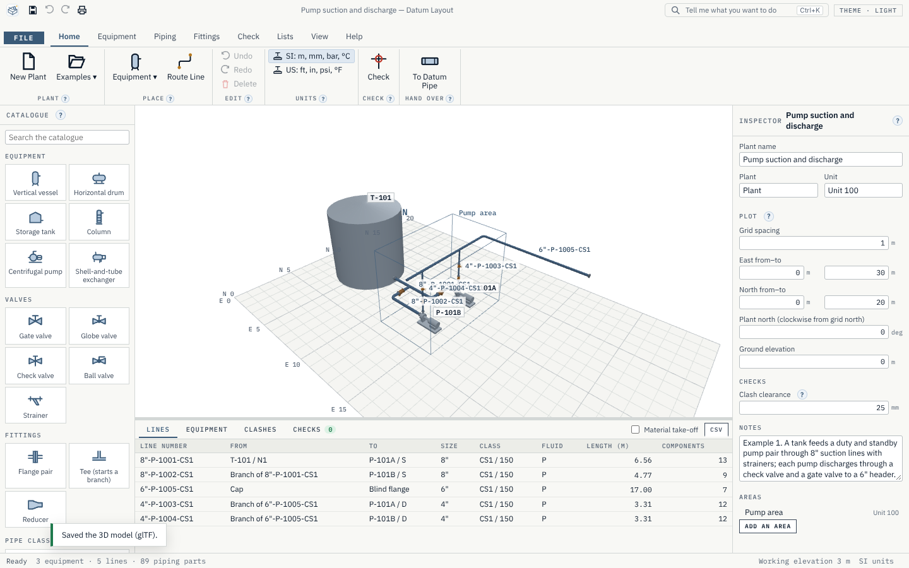

<p align="center"></p>

<h1 align="center">Datum Layout</h1>

<p align="center">3D plant layout and piping: place equipment, route lines, check and hand over.</p>

<p align="center">
  <a href="https://github.com/Edgar-Mendonca/Datum-Layout/releases"></a>
  <a href="https://github.com/Edgar-Mendonca/Datum-Layout/actions/workflows/ci.yml"></a>
  <a href="https://github.com/Edgar-Mendonca/Datum-Layout/releases"></a>
  
  
  
  
  
</p>

<p align="center">
  <a href="https://github.com/Edgar-Mendonca/Datum-Layout/releases/latest"></a>
  <a href="CHANGELOG.md"></a>
  <a href="docs/MEMORY.md"></a>
</p>



Place equipment from its datasheet sizes, route pipes between nozzles, and the elbows, tees, flanges and valves appear and size themselves from the line's size and pipe class. Drag a valve onto a pipe and it snaps into place. Then check for clashes, list every line and its materials, and send each line to Datum Pipe for its isometric and stress analysis. It is for piping and layout designers, mechanical and process engineers, and students learning plant design. It is free and open source (MIT), Windows first, installs in seconds and updates itself. More on the family site: [edgar-mendonca.github.io/Datum/apps/layout](https://edgar-mendonca.github.io/Datum/apps/layout).

## What it does

- **Place the equipment.** Vertical vessels, horizontal drums, storage tanks, columns, centrifugal pumps with motor and baseplate, and shell-and-tube exchangers, drawn from a few datasheet sizes, each with its nozzles (size, rating, facing, position, direction).
- **Route the lines.** Click from nozzle to nozzle with orthogonal guides: spec elbows at every turn (long or short radius), reducers where sizes change, weld-neck flanges, gaskets and bolt sets at flanged nozzles.
- **Drop the fittings.** Valves, strainers, flange pairs, tees and reducers snap onto the pipe by their ports, take the line's size and class, and split the pipe. A tee starts a branch. Resize a line and everything on it re-sizes.
- **Check.** Clashes (pipe–pipe, pipe–equipment, pipe–ground) with a clearance, open ends, mismatches, class rules and missing line numbers, each one a click away.
- **Hand over.** Line list, equipment and nozzle list, material take-off (CSV); a piping component file (.pcf) per line for Datum Pipe; glTF 2.0 for any 3D viewer; print to PDF.

Every part is **generated** from a dimension table and a shape rule, never downloaded: each table row names its source ([catalogue/SOURCES.md](catalogue/SOURCES.md)), and plug-in packs add your company's pipe classes and parts. Check dimensions against your supplier's data before ordering or building.

## The Datum family

Datum Layout works with **Datum Schema** (P&IDs; its plant package arrives in Layout 0.2) and **Datum Pipe** (isometrics and stress). See [docs/MEMORY.md](docs/MEMORY.md) for the roadmap and how it is built, and the family's design guide in [Edgar-Mendonca/Datum](https://github.com/Edgar-Mendonca/Datum/blob/HEAD/FAMILY.md).

## Build from source

```bash
npm ci
npm run build:ui
cargo test --workspace
npx tauri build --bundles nsis
```

MIT licence, © 2026 Edgar Mendonca. Product and file-format names are trademarks of their owners and are used only to describe file compatibility.
